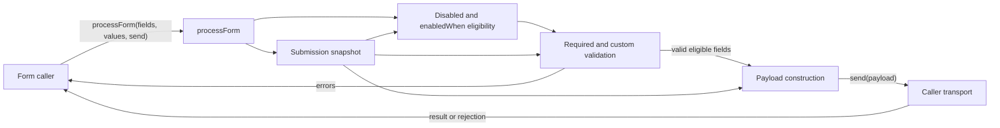

# Conditional field submission design

## Requirement and established contracts

`processForm(fields, values, send)` already owns field eligibility, validation, and
payload construction for one submission. A field with `enabledWhen(values)` must
join that same flow only when the predicate is truthy. A statically disabled field
always stays inactive and must not invoke its predicate. Inactive fields are neither
validated nor submitted. Predicate, validator, and payload construction use one
shallow top-level value snapshot captured at submission start, so caller mutations
during asynchronous validation cannot change the in-flight submission.

Existing required-value, custom-validation, rejection, unknown-key, and
prototype-like-key behavior remains unchanged. Predicates are evaluated once per
non-disabled conditional field per submission; thrown predicate errors propagate
without calling `send`.

## Ordered implementation increments

There are two dependency-ordered increments:

1. **Freeze the submission view and resolve eligibility.** In
   `src/process-form.js`, `processForm` captures a shallow snapshot, excludes
   disabled fields, and evaluates each remaining `enabledWhen` once against that
   snapshot. Complete when inactive and disabled fields invoke no validator and a
   thrown condition reaches the caller unchanged.
2. **Use the resolved view through validation and transport.** The existing
   validation loop and payload construction read only the snapshot and the resolved
   eligible field list. Complete when an input mutation during awaited validation
   does not affect later validators or the payload, while the original form contract
   tests still pass.

## Code contracts and ownership

- Changed public operation: `processForm(fields, values, send): Promise<unknown>`.
  It owns the per-call snapshot and eligibility decision, awaits validators in field
  order, returns `{ errors }` on validation failure, otherwise returns `send`'s
  result. Predicate, validator, and transport exceptions are not caught.
- Changed field input: `enabledWhen?: (snapshot) => unknown` is an optional
  synchronous predicate. Truthy means active. `disabled` has precedence.
- Reused contracts: required emptiness and validator invocation are unchanged;
  `Object.defineProperty` and `Object.fromEntries` retain safe own properties for
  names such as `__proto__`.
- State and effects: the caller owns mutable `values`; `processForm` owns its
  shallow per-call snapshot and the single `send` effect. No shared state or cleanup
  is introduced.

## Technical architecture



## Submission data flow

```mermaid
sequenceDiagram
  participant C as Caller
  participant P as processForm
  participant F as Field callbacks
  participant S as send
  C->>P: fields, mutable values, send
  P->>P: capture shallow snapshot
  loop each non-disabled field
    P->>F: enabledWhen(snapshot), once if present
    F-->>P: active or inactive
  end
  loop each active field
    P->>F: validate(snapshot[name], snapshot)
    F-->>P: error or undefined
  end
  alt validation errors
    P-->>C: { errors }
  else valid
    P->>P: build payload from active fields and snapshot
    P->>S: payload
    S-->>C: transport result
  end
  Note over P,F: Predicate or validator throws propagate; send is not called
```

## Verification and evolution

Both increments are implemented. `npm run check` passes all 13 tests and covers
inactive/disabled branches, once-per-submit evaluation, snapshot consistency across
an async pause, thrown conditions, prototype-like keys, and all pre-existing
behavior. `git diff --check` also passes. Mermaid sources are kept inline; this
repository has no configured Mermaid renderer, so diagram rendering is not an
executed check.

A realistic follow-up is supporting a second predicate such as visibility while
keeping submission eligibility distinct. The resolved eligibility calculation is a
single boundary where that rule can later be composed; no general rule engine is
needed now.
