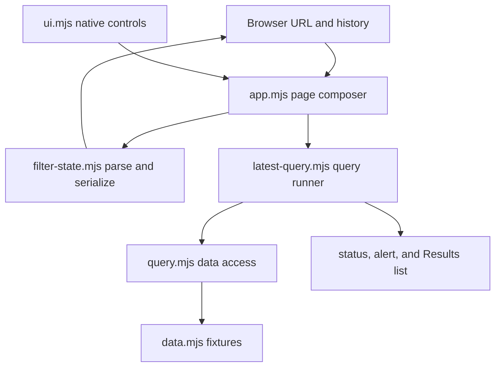
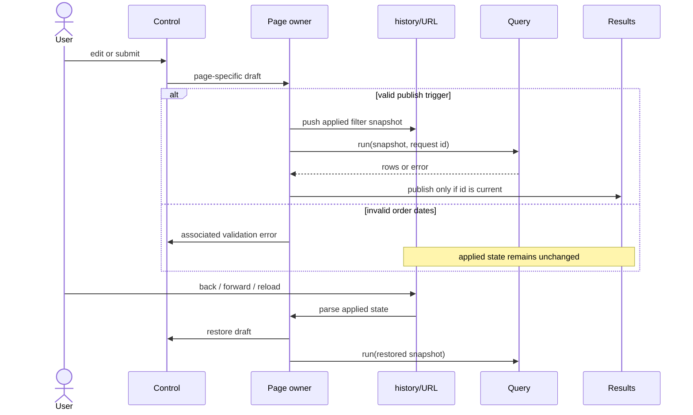

# Product and order filtering design

## Outcome and contracts

The application has two URL-addressable pages. Products expose keyword, category,
and publication-status filters as an editable draft that is published only by
Apply. Orders expose keyword, date range, and order-status filters; every valid
edit is published immediately. Reset publishes each page's documented defaults.
Unknown query parameters are preserved, and `popstate` rebuilds both controls and
results from the URL.

The URL stores only applied values (`p_q`, `p_category`, `p_status`, `o_q`,
`o_from`, `o_to`, `o_status`). Parsers accept only known enum values and valid ISO
calendar dates, falling back per field to page defaults. Serializers omit default
values so links remain concise. Product defaults are empty keyword, all categories,
and published status. Order defaults are empty keyword, all statuses, and the 30
calendar days ending on `today` from `data.mjs`.

Order date edits remain in the controls while either value is incomplete or the
range is reversed. The form shows an associated error and retains the previously
applied URL and results. Once the range is valid, the whole draft is published.
This distinction keeps editable state separate from navigable state.

Every query has a monotonically increasing identity. Only the current identity may
publish success, error, or completion feedback; superseded responses are ignored.
The previous result stays visible while a query is pending or fails. A current
failure is presented as an alert, while a current success replaces rows, count,
and any prior query error together.

## Architecture

`ui.mjs` continues to own reusable labelled native controls. `filter-state.mjs`
owns pure filter defaults, URL codecs, and date-range validation. `app.mjs` owns
page semantics, drafts, URL transitions, history restoration, and result view.
`latest-query.mjs` owns request identity and publication order, while `query.mjs`
remains the asynchronous data boundary. Both pages share
the navigation and result shell, while their distinct application rules remain in
separate setup functions.

## Data flow

## Implementation sequence and acceptance

1. Add URL/date helpers in `filter-state.mjs`: parse canonical page filters, serialize by
   replacing only owned keys, and compute the inclusive 30-day order default.
   Acceptance: unrelated parameters survive; unknown enums/dates become defaults;
   history and reload recreate controls and queries.
2. Add a shared result view and latest-result runner. The runner receives an
   immutable filter snapshot and query function, and owns request identity and
   current feedback. Acceptance: slow earlier success/error/finalization cannot
   replace current rows or feedback; visible counts equal returned rows.
3. Compose the product page with native controls and form submission. Draft edits
   have no external effect; Apply pushes the complete draft and queries; Reset
   publishes product defaults. Acceptance: Enter follows native submit behavior,
   category/status rules stay product-specific, and back/forward restores drafts.
4. Compose the order page with native controls and input/change publication.
   Validate both dates as a single range before URL/query effects; Reset publishes
   the documented range. Acceptance: invalid drafts remain editable with an alert
   associated to both date inputs, while valid edits immediately update results.
5. Make the form layout intrinsic and wrapping, with controls allowed to shrink to
   the container. Acceptance: native keyboard behavior remains intact and the page
   has no horizontal overflow at 360 px with 200% text and long labels.
6. Run the browser acceptance suite and inspect changed callers. A realistic next
   change—adding a new enum option—should require updating only its options/default
   and the relevant page codec/control, without changing request-ordering policy.

## Verification record

- `node --test test/*.test.mjs`: 7 tests passed, covering defaults, URL codecs,
  calendar/range validation, and latest-result publication across reordered
  success and failure.
- `node --check` passed for all source modules.
- `git diff --check` passed.
- `npm run check` was attempted after `npm ci --ignore-scripts`; the evaluation
  sandbox rejected the Playwright server's `127.0.0.1` listen call with `EPERM`,
  before any browser test ran. A direct Chromium launch was also rejected by the
  sandbox's macOS Mach-port policy, so browser layout and interaction acceptance
  remain to be run in an environment that permits the supplied harness.
