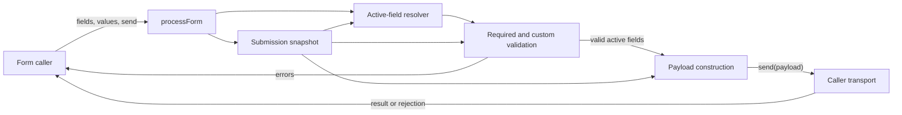
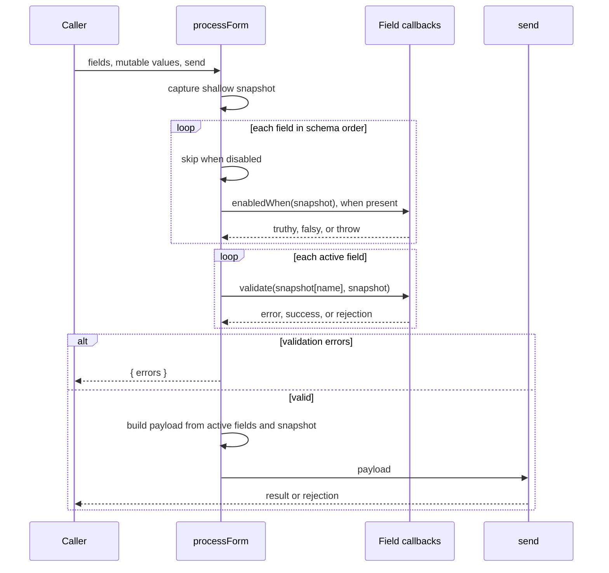

# Conditional field submission design

## Requirement and established contracts

`processForm(fields, values, send)` must support an optional synchronous
`enabledWhen(values)` predicate on a field. On every submission, a field is active
when it is not disabled and either has no predicate or its predicate returns a
truthy value. Inactive fields are neither validated nor included in the payload.

The existing required-value, custom-validation, error, transport, own-property,
and rejection behavior remains unchanged. Conditions, validators, and payload
construction use one shallow top-level snapshot captured at submission start so
caller mutations during awaited validation cannot mix states. A disabled field
does not run its condition. Predicate failures propagate unchanged, like validator
and transport failures.

## Implementation sequence

The change has two dependency-ordered increments, both completed:

1. **Resolve submission state and active fields.** In `src/process-form.js`, copy
   `values` once and filter fields in schema order, checking `disabled` before
   invoking `enabledWhen`. Completion: conditions run once per non-disabled field,
   inactive fields leave no validation or payload effects, and all later work uses
   the captured snapshot.
2. **Preserve and document the public contract.** Reuse the existing validation
   and payload flow over active fields, passing the snapshot to validators and
   reading payload values from it; document `enabledWhen` in `README.md`.
   Completion: both original and conditional-field acceptance tests pass.

## Code contracts

- `processForm(fields, values, send): Promise<unknown>` remains the sole public
  operation and owns the submission snapshot, active-field resolution, ordered
  validation, and the single transport call.
- `field.enabledWhen(snapshot): unknown` is optional and synchronous. Its truthiness
  controls participation for that submission; exceptions are not caught.
- `field.validate(value, snapshot)` remains sync or async. It only runs for active
  fields, after the required check, against the same snapshot used by conditions.
- `send(payload)` remains responsible for transport. It runs once after successful
  validation and receives only active schema fields as own properties.

No persistent state, migration, cancellation, or recovery mechanism is introduced;
rejections continue to be the caller's responsibility.

## Technical architecture

## Data flow

## Verification and evolution

Executed `npm run check` successfully (13/13 tests). It covers inactive behavior, per-submission recalculation, disabled
precedence, snapshot consistency under caller mutation, exception identity,
prototype-like keys, and all original submission rules. A realistic follow-up is
adding another condition type; active-field resolution is isolated as one phase,
so that rule can be extended without changing validation or transport semantics.
The Mermaid sources are retained here; this repository has no Mermaid parser, so
their rendering is reviewed structurally but not tool-validated.
