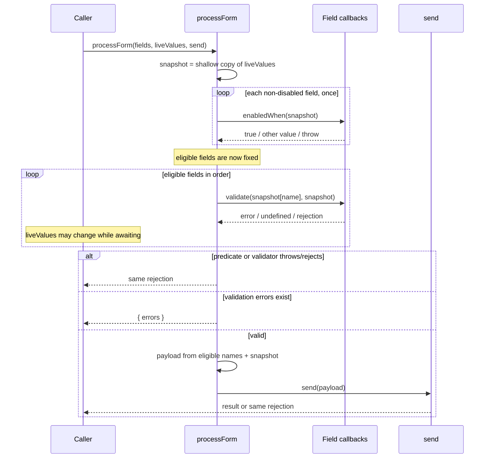

# Conditional form fields

## Requirement and current contract

`processForm(fields, values, send)` remains the only public entry point. A field may
add a synchronous `enabledWhen(values)` predicate. A disabled field is always
excluded and its predicate is not called. Every other conditional field participates
in required validation, custom validation, and the payload only when its predicate
returns exactly `true`.

At the start of each call, `processForm` takes one shallow, top-level value snapshot.
Predicates run once against that snapshot before validation begins. Required checks,
custom validators, and payload construction all use the same snapshot, so edits to
the caller-owned object while an async validator is pending cannot alter that
submission. Predicate, validator, and transport exceptions retain the existing
promise-rejection behavior and identity. Existing required-value rules, own keys such
as `__proto__`, unknown-value omission, sequential validation, and zero-dependency
operation remain unchanged.

## Ordered implementation

The change has two dependency-ordered steps:

1. **Capture submission input and resolve eligibility.** In
   `src/process-form.js`, create the shallow snapshot before inspecting fields, then
   select eligible fields in declaration order. Check `disabled` before invoking
   `enabledWhen`; invoke each applicable predicate once and retain only an exact
   `true`. Completion is demonstrated by inactive/disabled fields being absent and
   predicate exceptions propagating unchanged.
2. **Use the resolved submission consistently.** Validate eligible fields and build
   their payload exclusively from the captured snapshot. Keep existing required
   short-circuiting, error construction, async sequencing, and `send` return/error
   behavior. Completion is demonstrated by mutating the original values during an
   async validator and observing the original values in later validators and the
   payload, plus the complete original and conditional test suites passing.

## Supporting contracts

- **Changed public field shape:** existing field properties are unchanged; optional
  `enabledWhen: (valuesSnapshot) => boolean` adds eligibility. There is no new export.
- **`processForm(fields, values, send): Promise<unknown | { errors }>`:** owns the
  per-call snapshot, fixed eligible-field list, validation errors, and final payload.
  Callers continue to own `fields` and `values`; neither is mutated.
- **`field.validate(value, valuesSnapshot)`:** retains its sync/async result and
  rejection contract, but receives the per-submission snapshot rather than the live
  caller object. This is the same object observed by every predicate and validator
  in that submission.

## Technical architecture

```mermaid
flowchart LR
  Caller[Form caller] -->|fields, live values, send| PF[processForm]
  PF -->|shallow copy| Snapshot[Submission snapshot]
  PF -->|disabled then enabledWhen(snapshot)| Eligibility[Fixed eligible fields]
  Snapshot --> Eligibility
  Eligibility --> Validation[Required and custom validation]
  Snapshot --> Validation
  Validation -->|errors| Caller
  Validation -->|valid eligible names| Payload[Payload construction]
  Snapshot --> Payload
  Payload -->|send(payload)| Transport[Caller-provided send]
  Transport -->|result or rejection| Caller
```

## Submission data flow



## Verification and evolution

`npm run check` passes 15 tests. It covers original field semantics, inactive and
disabled branches, once-per-submission predicates, exception identity,
prototype-like names, and the async-edit race. The focused contract tests also
confirm that only exact `true` enables a conditional field and that all predicates
finish before validation starts.

A realistic next change is nested-path fields. This design deliberately defines a
top-level shallow snapshot; nested cloning can later be introduced at the snapshot
boundary if the public contract changes, without changing eligibility or validation
ownership. No migration or rollback mechanism is needed because `enabledWhen` is
optional and existing fields follow their prior path.
