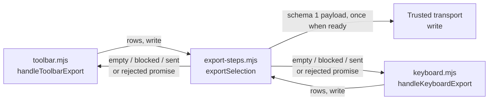
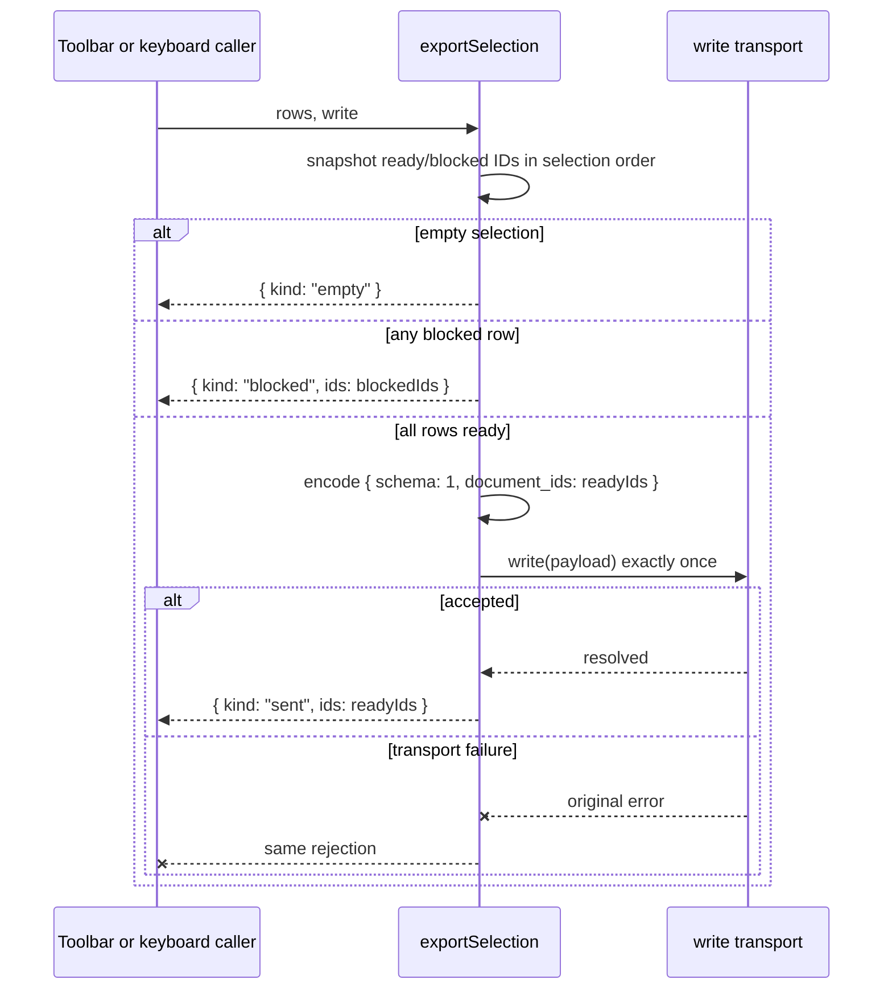

# Selection export responsibility refactor

## Requirement and established contracts

Toolbar and keyboard are public entry points for the same complete selection-export
intent. Today both callers know and repeat the internal `begin -> classify -> encode
-> dispatch` sequence. The refactor must move that sequence behind one operation
without changing these inspected contracts:

- `handleToolbarExport(rows, write)` and `handleKeyboardExport(rows, write)` remain
  public and return the export operation's promise.
- Empty and blocked selections do not write and return the existing outcomes.
- A ready selection preserves row order, submits protocol schema 1 exactly once,
  and returns `sent` only after `write` accepts it.
- IDs are snapshotted before the asynchronous boundary; caller rows remain
  unmodified. A rejected `write` rejects with the same error.
- `rows` is validated internal data and `write` is the trusted existing transport.
  This refactor does not add a pausable workflow, plugin boundary, or dependency.

The existing test suite is the authoritative observable-behavior check. The source
modules are internal except for the two named entry points.

## Ordered implementation (2 steps)

1. **Own a complete export intent in `src/export-steps.mjs`.** Replace the exposed
   mutable step protocol with `exportSelection(rows, write)`. It derives an outcome
   from a stable ID snapshot, returns early for empty/blocked selections, constructs
   the owned wire payload for ready selections, awaits one `write`, and returns the
   accepted outcome. Completion check: existing tests preserve outcomes, ordering,
   one-write behavior, pending-write stability, and original error identity.
2. **Reduce both public entry points to intent adapters.** Update
   `handleToolbarExport` and `handleKeyboardExport` to delegate their inputs once to
   `exportSelection`, preserving their names, arguments, and return values.
   Completion check: the suite exercises both public imports and all five contract
   branches for each.

## Supporting code contracts

- **New internal contract:** `exportSelection(rows, write) -> Promise<Outcome>` in
  `src/export-steps.mjs` owns eligibility, schema encoding, transport invocation,
  acceptance, and error propagation as one operation.
- **Preserved public contracts:** `handleToolbarExport(rows, write)` and
  `handleKeyboardExport(rows, write)` delegate and return that promise unchanged.
- **Retired internal contracts:** `begin`, `classify`, `encode`, and `dispatch` have
  no public consumers and are removed with their mutable intermediate context.

## Technical architecture

The entry modules own trigger identity only. The export module owns the complete
domain operation and wire-protocol knowledge; transport remains injected.

## Data flow

## Verification and evolution

The baseline suite passed all 10 tests. After implementation, the same command,
`node --test test/export.test.mjs`, passed all 10 tests again. `git diff --check`
also passed, and no retired step symbol remains under `src`.

A realistic protocol change, such as schema 2 renaming `document_ids`, now changes
only `exportSelection`; neither trigger adapter gains protocol knowledge. If a new
trigger is added, it can express the same complete intent through the same narrow
operation without extending a generic workflow mechanism.

Implementation status: both ordered steps completed.
