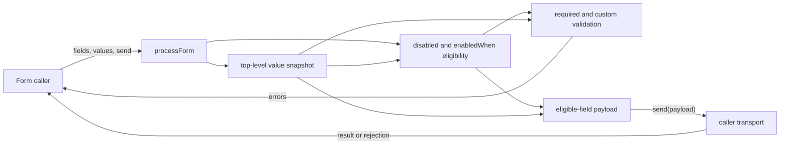
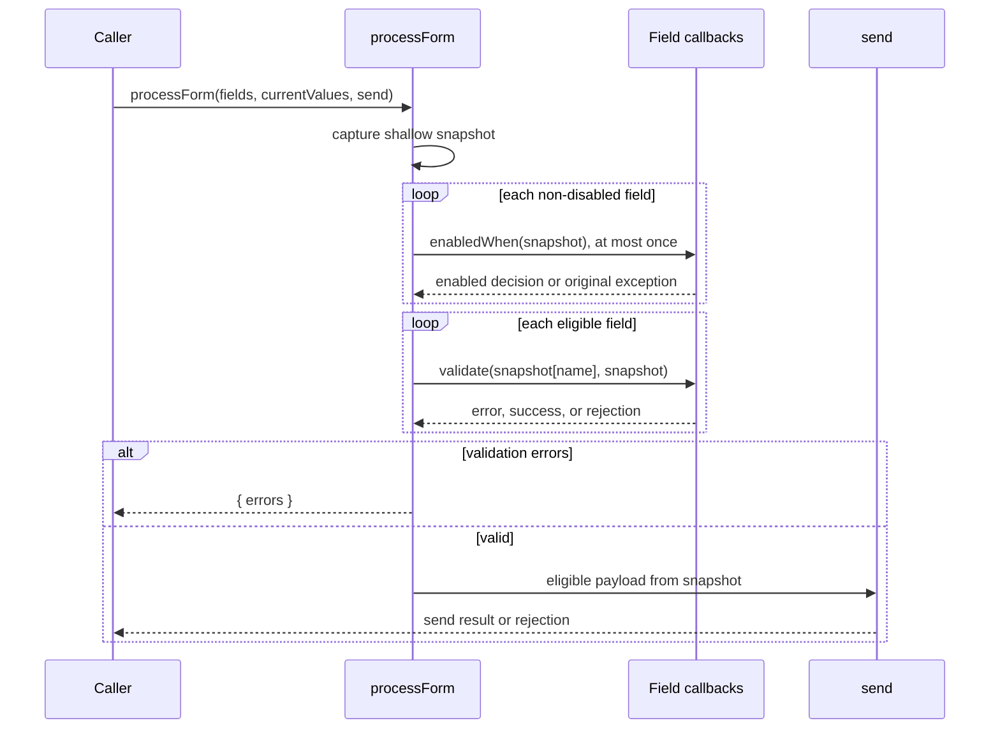

# Conditional form fields

## Requirement and established contracts

`processForm(fields, values, send)` remains the only public entry point. A field may
add a synchronous `enabledWhen(values)` predicate. Disabled fields take precedence
and never invoke that predicate. Only enabled fields participate in required checks,
custom validation, and the submitted payload.

Each invocation captures the current own top-level values before any field decision.
Every predicate is evaluated exactly once against that snapshot, and validators and
payload construction use the same snapshot. Predicate errors propagate unchanged,
as validator and transport errors already do. Existing required-value rules,
prototype-like field names, sequential async validation, and the zero-dependency
contract remain unchanged.

## Implementation sequence

The change has two dependency-ordered increments:

1. In `src/process-form.js`, capture an own-key top-level snapshot and resolve the
   submission's eligible field list. Completion means disabled fields skip their
   predicate, false predicates exclude the field everywhere, predicates run once,
   and thrown errors escape with their identity intact.
2. Route existing required checks, custom validators, and payload construction
   through the captured snapshot and resolved list. Completion means editing the
   caller's values while an async validator is pending cannot change validator
   inputs or the sent payload, while all original tests still pass.

## Code contracts and ownership

- `processForm(fields, values, send): Promise<unknown>` owns one complete submission
  attempt: it captures state, resolves eligibility, validates in field order, and
  either returns `{ errors }` or the unchanged result of `send(payload)`.
- `field.enabledWhen(snapshot): boolean` is an optional synchronous caller callback.
  It is called once only when `field.disabled` is falsy. Its return value is used as
  the field's eligibility decision for the entire attempt; its exception is not
  wrapped or converted.
- The snapshot is a shallow value capture of the input object's own keys. Nested
  object identity is intentionally unchanged; this feature protects the form's
  top-level field values without introducing cloning semantics into the API.

## Technical architecture

## Submission data flow

## Verification and evolution

`npm run check` covers inactive, active, strict-true, disabled, thrown-predicate,
prototype-key, non-enumerable own-key, snapshot-race, original validation, and
transport behavior. It passed after implementation. Mermaid sources were inspected
but no renderer is installed in this zero-dependency project, so rendered diagram
syntax was not independently checked. A realistic next change is another eligibility
rule: it can be incorporated where the eligible list is resolved without duplicating
checks across validation and payload construction. No migration or recovery mechanism
is needed because fields without `enabledWhen` retain their current behavior.
