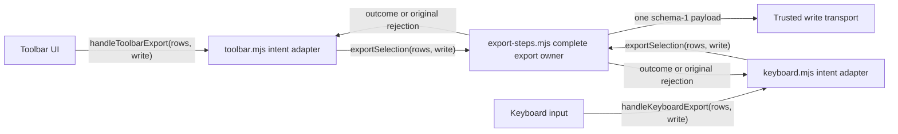
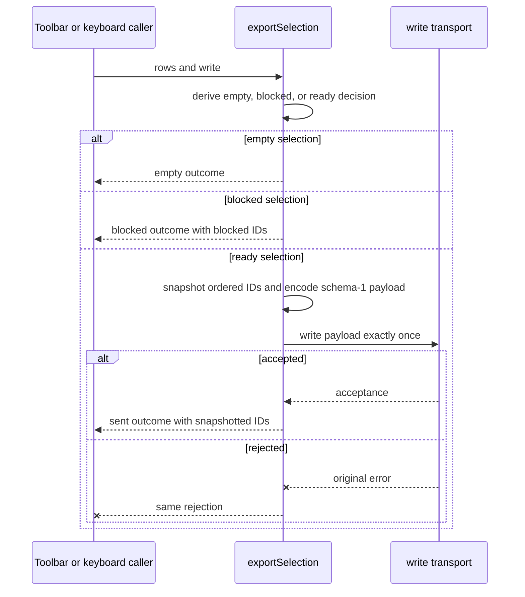

# Selection export responsibility refactor

## Requirement and established contracts

Toolbar and keyboard callers each express one complete selection-export intent.
They must not know the internal preparation, eligibility, protocol encoding, or
transport sequence. The existing public operations remain
`handleToolbarExport(rows, write)` and `handleKeyboardExport(rows, write)`.

Inspected contracts from `README.md`, the source, and the baseline tests:

- Empty and blocked selections do not write and return their existing outcomes.
- A ready selection preserves row order and is submitted exactly once as
  `{ schema: 1, document_ids: ids }`.
- IDs are captured before the asynchronous write, caller rows are not mutated,
  and a successful write returns `{ kind: 'sent', ids }`.
- A rejected write rejects with the original error.
- `write` is trusted to borrow rather than mutate the payload.

This is a responsibility change only. It adds no pausable stages, plugin system,
dependency, or new public entry point.

## Ordered implementation

The change has two dependency-ordered steps:

1. **Own the complete export in `src/export-steps.mjs`.** Replace the exported
   mutable-context stages with `exportSelection(rows, write)`. The operation
   decides eligibility, snapshots ready IDs, constructs the versioned payload,
   awaits one write, and returns the established outcome. Completion check: the
   existing empty, blocked, ordered payload, stable-ID, and original-error cases
   pass through either consumer.
2. **Reduce both public entry points to intent adapters.** Update
   `handleToolbarExport` and `handleKeyboardExport` to call
   `exportSelection(rows, write)` once and return its promise/result unchanged.
   Completion check: all existing tests pass for both public entry points, and
   neither entry point imports an individual export stage.

## Supporting contracts and ownership

- `handleToolbarExport(rows, write)` (`src/toolbar.mjs`): unchanged public toolbar
  entry; delegates the whole intent and preserves its return/rejection.
- `handleKeyboardExport(rows, write)` (`src/keyboard.mjs`): unchanged public
  keyboard entry; delegates the whole intent and preserves its return/rejection.
- `exportSelection(rows, write)` (`src/export-steps.mjs`): internal orchestration
  seam. It owns eligibility rules, the accepted ID snapshot, schema-1 encoding,
  transport ordering, and outcome construction. Its input and result match the
  existing entry contracts; it does not catch transport errors or mutate rows.

No class or generalized interface is warranted: there is one operation, one
trusted transport capability, and no independent lifecycle or substitution need.

## Technical architecture

The adapters depend on the cohesive export operation; protocol and sequencing do
not depend on either UI trigger.

## Data flow

## Verification and evolution

Run `node --test test/export.test.mjs` after both steps. This is decisive at the
two supported consumer boundaries and covers no-write branches, all-or-nothing
eligibility, order, one write, protocol shape, row immutability, pending-write ID
stability, and error identity. Also inspect the diff to confirm the old staged API
has no remaining consumer.

A realistic next change is schema 2 requiring another payload field. It changes
only `exportSelection`'s encoding/send portion; neither UI entry point changes.
If eligibility later becomes sufficiently complex, a private pure decision helper
can be extracted without changing the consumer contract.

Status: both implementation steps are complete. On 2026-10-19,
`node --test test/export.test.mjs` passed all 10 tests, the old stage names had no
remaining references under `src` or `test`, and `git diff --check` passed. No
Mermaid renderer is configured in this repository, so diagram rendering was not
machine-verified.
